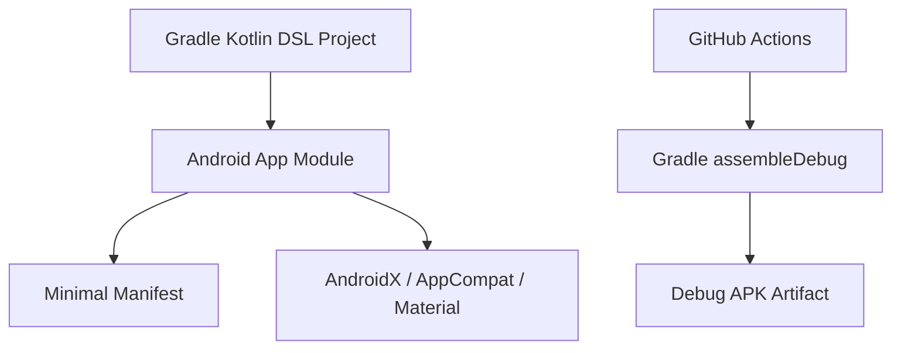

# CLT ALY — Android Project Skeleton

[](https://developer.android.com/)
[](https://kotlinlang.org/)
[](.github/workflows/android.yml)
[](#proof-of-concept--enterprise-customization-readiness)

**CLT ALY is currently a minimal Android Gradle project skeleton.** It has an Android application module and a GitHub Actions APK-build workflow, but no Activity, Fragment, Kotlin/Java application source, screens, or executable product behavior.

A successful APK build demonstrates build-tool configuration only; it does not mean the APK is a usable application.

## 1. Project Overview & Problem Statement

The repository appears to reserve an Android application identity under `com.clt.aly`. No product brief or implemented use case is present in the current source tree.

The current deliverable consists of:

- A Gradle Kotlin DSL project.
- One Android application module.
- A minimal Android manifest with application label `CLT ALY`.
- Version-catalog-managed Android Gradle Plugin, Kotlin, AndroidX Core, AppCompat, and Material dependencies.
- A GitHub Actions workflow that builds and uploads a debug APK.

### Current architecture



No UI, navigation, domain logic, data layer, networking, persistence, or CLT service integration is implemented.

## 2. Tech Stack & Versions

| Component | Declared version |
|---|---|
| Android Gradle Plugin | 8.1.0 |
| Kotlin Android plugin | 1.8.10 |
| Android compile SDK | 33 |
| Android target SDK | 33 |
| Android minimum SDK | 24 |
| AndroidX Core KTX | 1.10.1 |
| AppCompat | 1.6.1 |
| Material Components | 1.9.0 |
| CI JDK | 17 (Temurin) |
| Build system | Gradle Wrapper, Kotlin DSL |

Versions are declared in [`gradle/libs.versions.toml`](gradle/libs.versions.toml) and [`app/build.gradle.kts`](app/build.gradle.kts).

## 3. Prerequisites & Dependencies

- Git.
- JDK 17.
- Android SDK Platform 33 and compatible build tools.
- Gradle Wrapper (included in the repository).
- Android Studio is optional for local inspection and future UI development.

The CI workflow uses GitHub-hosted Ubuntu and installs JDK 17. No external API key, database, backend, model, or paid service is required to build the current skeleton.

## 4. Installation & Local Setup

Clone the repository:

```bash
git clone https://github.com/zopair/-CLT_ALY.git
cd -CLT_ALY
```

Build the debug APK:

```bash
chmod +x gradlew
./gradlew assembleDebug
```

Expected output path:

`app/build/outputs/apk/debug/app-debug.apk`

The artifact can be installed on a compatible Android device for package/build inspection. The current manifest declares no launcher Activity, so the resulting APK should not be treated as a user-launchable app.

## 5. Environment Variables

No environment variables, secrets, API keys, or runtime configuration are defined.

The current build is self-contained apart from the Android Gradle dependencies downloaded by Gradle.

## 6. Usage Guide & Core Features

### Current build features

- Android application package configuration.
- Namespace/application ID: `com.clt.aly`.
- Application label: `CLT ALY`.
- Debug APK build through Gradle.
- GitHub Actions artifact upload.

### Not implemented

- Launcher Activity or user interface.
- Login, profile, settings, or navigation.
- CLT agent integration or background execution.
- Network/API clients.
- Database or local persistence.
- Permissions beyond the minimal manifest.
- Notifications, services, workers, or device integrations.

## 7. Live Demo & Screenshots

No live application, Play Store listing, website, screenshots, or functional demo is present.

The only build evidence is the GitHub Actions artifact produced by the `Sovereign Build` workflow.

## 8. Testing & Verification

There is no application unit-test or instrumentation-test suite in the current repository tree.

The workflow `.github/workflows/android.yml` performs:

```bash
./gradlew assembleDebug
```

### CI evidence observed during this review

- **Sovereign Build:** [run #43113085916](https://github.com/zopair/-CLT_ALY/actions/runs/43113085916) on 11 November 2026 — Success.
- The workflow built and uploaded `app-debug.apk`.
- This confirms Gradle compilation/package generation only. It does not test app launch, screens, user flows, permissions, or runtime behavior.

## Proof of Concept & Enterprise Customization Readiness

**Status: Android build skeleton — not yet a PoC application.**

| Area | Current state |
|---|---|
| Gradle project | Present |
| Android app module | Present |
| Kotlin / Java source | None |
| Launcher Activity | None |
| UI / navigation | None |
| Backend / API integration | None |
| Local persistence | None |
| Unit / instrumentation tests | None |
| CI APK build | Successful historical run |
| Runtime usability | Not demonstrated |
| Project license | No root `LICENSE` file present |

### Readiness gates

1. Define the app's user problem and intended relationship to the wider CLT ecosystem.
2. Add a launcher Activity and one testable screen before describing the APK as an app.
3. Define app architecture and permissions based on actual use cases.
4. Add unit and instrumentation tests, including emulator launch verification.
5. Add a privacy/data model and secure API boundary before handling user information.
6. Select a project license and document third-party dependency obligations.

## Intellectual Property & Authorship

Requested project attribution: **Aly Hussein Zopair (علي حسين زبير ALY HUSSEIN ZOPAIR)**.

This notice does not create a software license or override AndroidX, Kotlin, Material Components, or other third-party licenses.
